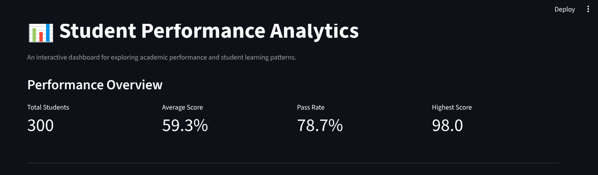
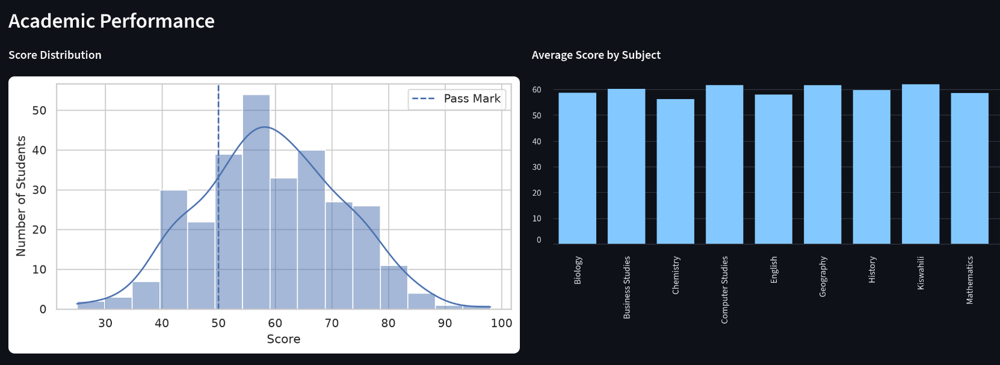
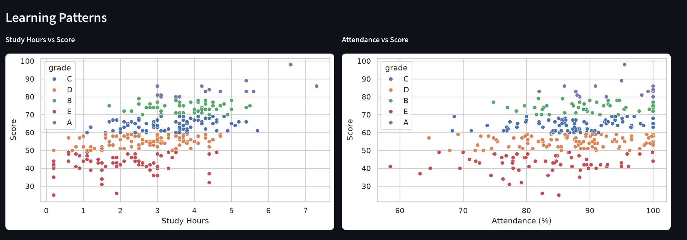
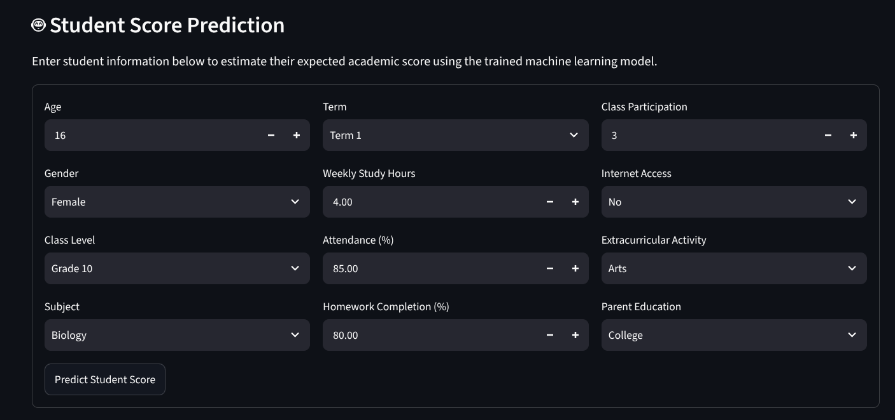

# 📊 Student Performance Analytics

**An interactive data science and machine learning project for analyzing student academic performance, identifying learning patterns, and predicting student scores.**


---

## 📌 Project Overview

Student Performance Analytics is an end-to-end data science project built with Python.

The project explores academic performance using student-related factors such as study hours, attendance, homework completion, classroom participation, and other learning characteristics.

It combines data cleaning, exploratory data analysis, statistical analysis, data visualization, advanced analytics, and machine learning into an interactive Streamlit dashboard.

The main objective is to transform raw student data into meaningful insights that can help educators understand academic trends, identify students who may need additional support, and explore potential factors associated with academic performance.

**Key objectives:**

- Analyze student academic performance.
- Identify relationships between learning habits and examination scores.
- Explore performance differences across subjects, classes, and terms.
- Identify students who may benefit from additional academic support.
- Build a machine learning model to predict student scores.
- Present analytical results through an interactive dashboard.

---

## 🖥️ Dashboard Preview

The project includes an interactive Streamlit dashboard with performance summaries, visual analytics, and machine learning predictions.

### 1. Dashboard Overview



The main dashboard provides a high-level overview of student performance.

**Key performance indicators include:**

- Total number of students.
- Average student score.
- Overall pass rate.
- Highest recorded score.

This section also provides an overview of academic performance and allows users to explore the dataset using interactive filters.

### 2. Performance Analysis



This section explores academic performance through statistical summaries and visualizations.

It helps users investigate:

- Score distributions.
- Performance across academic grades.
- Subject-level performance.
- Class-level performance.
- Pass and fail distributions.
- Differences in academic outcomes across student groups.

### 3. Advanced Analytics and Learning Patterns



This section explores relationships between student learning characteristics and academic outcomes.

The visualizations include:

- Study hours versus examination scores.
- Attendance versus examination scores.
- Correlation between numerical variables.
- Relationships between learning habits and performance.

The analytics also identify students who may need additional academic support using predefined performance indicators.

### 4. Student Score Prediction



This section demonstrates the machine learning functionality.

Users can enter student characteristics and obtain an estimated academic score using a trained Random Forest regression model.

The prediction interface helps demonstrate how machine learning can be integrated into an interactive educational analytics application.

**Note:** Predictions are estimates generated from synthetic training data and should not be treated as actual examination results or definitive measures of student ability.

---

## 🛠️ Technologies Used

| Technology | Purpose |
|---|---|
| Python | Main programming language |
| Pandas | Data manipulation and analysis |
| NumPy | Numerical computing |
| Matplotlib | Data visualization |
| Seaborn | Statistical visualization |
| Scikit-learn | Machine learning |
| Streamlit | Interactive dashboard |
| Joblib | Saving and loading trained models |
| Pytest | Automated testing |
| Poetry | Dependency and environment management |
| Git & GitHub | Version control and project hosting |

---

## 📂 Project Structure

```text
student-performance-analytics/
│
├── dashboard/
│   ├── __init__.py
│   └── app.py
│
├── data/
│   ├── raw/
│   │   └── students.csv
│   │
│   └── processed/
│       └── students_cleaned.csv
│
├── docs/
│   └── images/
│       ├── dashboard-overview.png
│       ├── performance-analysis.png
│       ├── advanced-analytics.png
│       └── student-prediction.png
│
├── models/
│   └── student_score_model.joblib
│
├── reports/
│   ├── visualizations/
│   ├── advanced_insights.txt
│   ├── class_performance.csv
│   ├── correlation_matrix.csv
│   ├── data_quality_report.csv
│   ├── feature_importance.csv
│   ├── machine_learning_metrics.csv
│   ├── outlier_report.csv
│   ├── score_correlations.csv
│   ├── student_score_predictions.csv
│   ├── students_for_support.csv
│   ├── subject_performance.csv
│   ├── term_performance.csv
│   └── validation_report.csv
│
├── src/
│   ├── analytics/
│   │   ├── advanced.py
│   │   ├── cleaning.py
│   │   ├── exploration.py
│   │   ├── machine_learning.py
│   │   ├── prediction.py
│   │   ├── statistics.py
│   │   └── visualization.py
│   │
│   └── visualization/
│       └── plots.py
│
├── tests/
│   ├── test_cleaning.py
│   ├── test_prediction.py
│   └── test_statistics.py
│
├── main.py
├── pyproject.toml
├── poetry.lock
├── .gitignore
└── README.md
```

---

## 📊 Dataset Description

The project uses a synthetic dataset containing 300 student records and 16 original columns.

The dataset includes the following attributes:

| Column | Description |
|---|---|
| student_id | Unique student identifier |
| name | Student name |
| age | Student age |
| gender | Student gender category |
| class_level | Academic class level |
| subject | Subject being studied |
| term | Academic term |
| grade | Academic performance grade |
| study_hours | Hours spent studying |
| attendance | Attendance percentage |
| homework_completion | Homework completion percentage |
| class_participation | Classroom participation score |
| internet_access | Internet availability |
| extracurricular_activity | Extracurricular activity |
| parent_education | Parent education category |
| score | Student examination score |

The dataset is synthetic and intended for educational and demonstration purposes. It does not represent actual students or a real school's academic records.

---

## 🧹 Data Cleaning and Preprocessing

The data cleaning pipeline prepares raw student records for statistical analysis and machine learning.

The preprocessing operations include:

- Standardizing column names.
- Converting numerical columns into appropriate data types.
- Handling invalid numerical values.
- Standardizing categorical values.
- Removing duplicate records.
- Handling missing numerical values.
- Detecting outliers using the Interquartile Range (IQR) method.
- Validating the cleaned dataset.
- Generating data quality reports.

Outliers are flagged for investigation rather than automatically removed.

The cleaned dataset is exported to:

```text
data/processed/students_cleaned.csv
```

---

## 📈 Exploratory Data Analysis

Exploratory Data Analysis (EDA) is used to understand the dataset and identify patterns before applying machine learning.

The analysis includes:

- Dataset dimensions and data types.
- Descriptive statistics.
- Missing-value analysis.
- Academic grade distributions.
- Student score distributions.
- Relationships between numerical variables.
- Correlation analysis.
- Performance comparisons across subjects, classes, and terms.

---

## 📉 Statistical Analysis

The statistical analysis module provides numerical summaries of academic performance.

It includes:

- Descriptive statistics.
- Grade distribution.
- Pass/fail analysis.
- Correlation analysis.
- Performance comparisons by grade.

The project uses a pass mark of 50.

### Key analytical findings

Based on the current synthetic dataset:

| Metric | Result |
|---|---:|
| Total records | 300 |
| Average score | 59.30 |
| Pass rate | 78.67% |
| Highest score | 98 |

### Correlation with student scores

| Variable | Correlation |
|---|---:|
| Study hours | 0.571 |
| Homework completion | 0.333 |
| Attendance | 0.331 |
| Class participation | 0.309 |
| Age | 0.046 |

Study hours show the strongest positive correlation with scores among these numerical variables.

Correlation does not establish causation.

---

## 🤖 Machine Learning

The project uses supervised machine learning to estimate student examination scores.

### Models implemented

1. Baseline regression model.
2. Random Forest regression model.

### Feature engineering

The model uses numerical and categorical features.

**Numerical features:**
- Age.
- Study hours.
- Attendance.
- Homework completion.
- Class participation.

**Categorical features:**
- Gender.
- Class level.
- Subject.
- Term.
- Internet access.
- Extracurricular activity.
- Parent education.

A preprocessing pipeline handles numerical and categorical data before model training.

### Model training

The dataset is divided into:

- 80% training data.
- 20% testing data.

The trained model is saved using Joblib:

```text
models/student_score_model.joblib
```

### Model evaluation

The models are evaluated using:

- Mean Absolute Error (MAE).
- Root Mean Squared Error (RMSE).
- R-squared (R²).

### Current model results

| Metric | Baseline | Random Forest |
|---|---:|---:|
| MAE | 9.85 | 7.92 |
| RMSE | 11.74 | 9.74 |
| R² | -0.029 | 0.292 |

The Random Forest model currently performs better than the baseline model on the test split.

However, its R² score indicates that substantial variation in student scores remains unexplained. Further model validation and improvement are necessary before considering real-world deployment.

---

## 🚀 Installation and Setup

Follow these instructions to run the project locally.

### Prerequisites

Make sure you have installed:

- Python 3.14 or a compatible version allowed by the project.
- Poetry.
- Git.

### 1. Clone the repository

```bash
git clone https://github.com/njohn-hub/Student-Performance-Analytics.git
```

### 2. Navigate into the project

```bash
cd Student-Performance-Analytics
```

### 3. Install dependencies

```bash
poetry install
```

### 4. Activate the virtual environment

You can use:

```bash
poetry env activate
```

Alternatively, execute commands directly through Poetry using `poetry run`.

### 5. Run the analytics pipeline

```bash
poetry run python main.py
```

This executes the data loading, cleaning, statistical analysis, visualization, advanced analytics, and machine learning pipeline.

### 6. Launch the Streamlit dashboard

```bash
poetry run streamlit run dashboard/app.py
```

Open the local dashboard in your browser:

```text
http://localhost:8501
```

---

## 🧪 Running Tests

The project includes automated tests for data cleaning, statistical analysis, and student score prediction.

Run the complete test suite:

```bash
poetry run pytest -v
```

Current test results:

```text
21 passed
```

All 21 tests passed in the latest recorded test run.

---

## 📁 Generated Reports

The project generates analytical reports and visualizations.

Examples include:

| Report | Description |
|---|---|
| data_quality_report.csv | Missing-value and data quality summary |
| outlier_report.csv | Detected numerical outliers |
| validation_report.csv | Dataset validation results |
| correlation_matrix.csv | Numerical feature correlations |
| score_correlations.csv | Correlations with student scores |
| subject_performance.csv | Subject-level performance |
| class_performance.csv | Class-level performance |
| term_performance.csv | Term-level performance |
| feature_importance.csv | Model feature importance |
| machine_learning_metrics.csv | Model evaluation metrics |
| students_for_support.csv | Students flagged for possible support |
| advanced_insights.txt | Automatically generated analytical insights |

Generated visualizations are stored in:

```text
reports/visualizations/
```

---

## 🔍 Key Features

- End-to-end data science workflow.
- Data cleaning and preprocessing.
- Exploratory data analysis.
- Statistical analysis.
- Interactive data visualizations.
- Streamlit dashboard.
- Advanced performance analytics.
- Student support screening.
- Machine learning score prediction.
- Model evaluation and feature importance.
- Automated testing.
- Exportable analytical reports.

---

## ⚠️ Limitations and Considerations

This project is an educational demonstration built with synthetic data.

Important considerations:

- The dataset does not represent a real student population.
- Model predictions are estimates, not guaranteed examination results.
- Correlation does not imply causation.
- Feature importance does not prove that a variable causes changes in academic performance.
- Student support screening uses predefined indicators and should not replace professional educator judgment.
- The current machine learning model has limited predictive performance and requires further validation.
- Before real-world use, the model should be evaluated on representative, independently collected data, with appropriate privacy and fairness safeguards.

---

## 🔮 Future Improvements

Potential improvements include:

- Cross-validation and more robust model evaluation.
- Hyperparameter tuning.
- Testing additional regression algorithms.
- Improved model interpretability.
- More advanced interactive dashboard features.
- Deployment to Streamlit Community Cloud.
- Automated CI testing with GitHub Actions.
- Improved dataset validation and monitoring.
- Evaluation of model fairness across relevant student groups.

---

## 👨‍💻 Author

**John Ndungu**

Aspiring Data Scientist and Software Developer.

- GitHub: [@njohn-hub](https://github.com/njohn-hub)

---

## 📄 License

No open-source license has been specified yet. All rights are reserved unless a license is added to this repository.

---

## ⭐ Support

If you find this project interesting, consider giving the repository a star on GitHub.

Your feedback and suggestions are welcome!